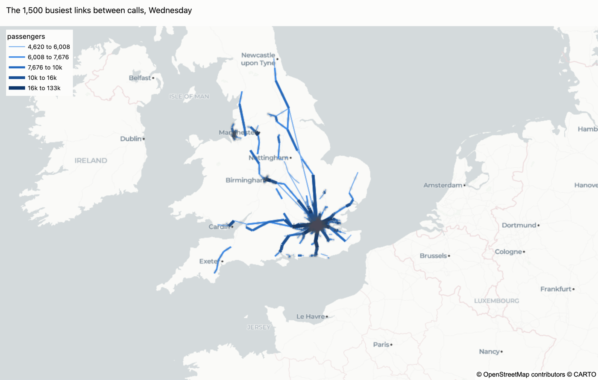
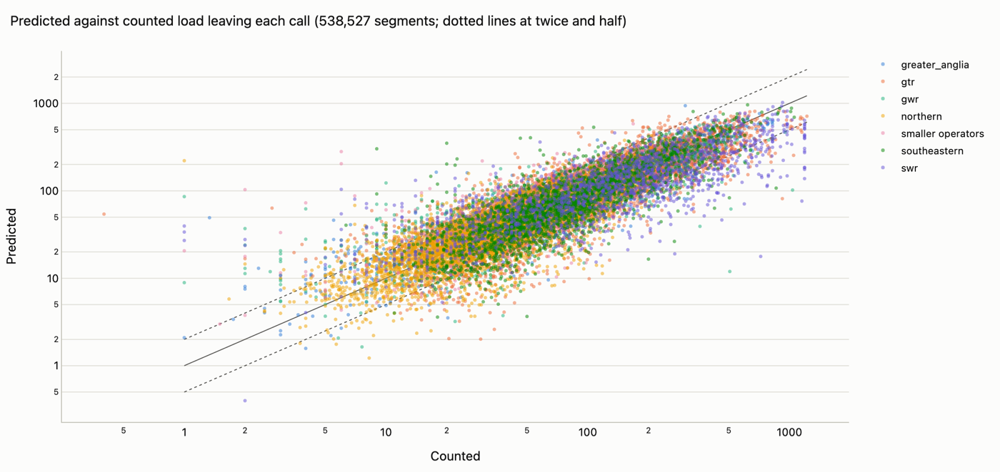
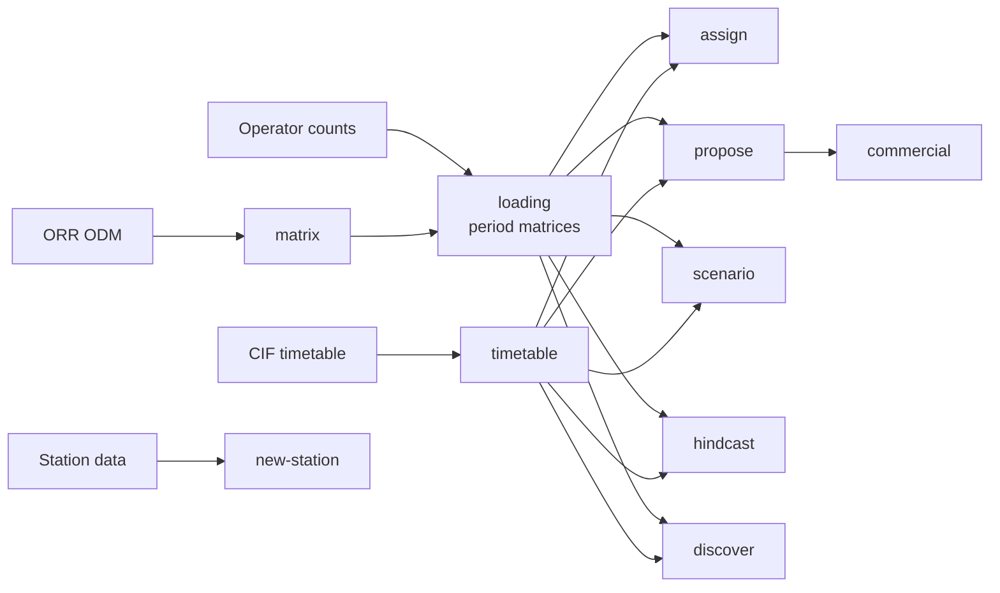

# ORTLA: Open Rail Train-level Assignment

Passenger demand for every train on the rail network in Great Britain.



ORTLA splits the ORR's annual origin to destination matrix (ODM) by day of the week and time of
day, using operators' loading counts, then puts that demand onto the timetable train by train.
One run loads the roughly 23,000 trains that run on a weekday and scores every load it can
match against the counts.

The same model forecasts new and retimed services (demand, timetable fit, TAG appraisal and the
operator's commercial case) and new stations. Services that have already launched can be
hindcast, so a forecast can be checked against what happened.

## Contents

- [Accuracy](#accuracy)
- [What it does](#what-it-does)
- [Installation](#installation)
- [Quick start](#quick-start)
- [Commands](#commands)
- [The adopted model](#the-adopted-model)
- [Desktop app](#desktop-app)
- [Data](#data)
- [Repository layout](#repository-layout)
- [Development](#development)
- [Licence](#licence)

## Accuracy

With the adopted settings, `ortla assign` was run over all five weekdays of the
timetable and scored against nine operators' counts.

| Operator | Counted segments | Predicted / counted | rmse(log) |
| --- | ---: | ---: | ---: |
| Avanti West Coast | 6,089 | 1.02 | 0.42 |
| Northern | 141,134 | 1.00 | 0.43 |
| Govia Thameslink Railway | 176,729 | 0.92 | 0.45 |
| Greater Anglia | 50,362 | 0.98 | 0.46 |
| Southeastern | 74,769 | 0.95 | 0.49 |
| South Western Railway | 50,614 | 0.95 | 0.53 |
| TransPennine Express | 14,858 | 1.01 | 0.58 |
| Great Western Railway | 31,726 | 0.96 | 0.61 |
| East Midlands Railway | 5,588 | 0.91 | 0.72 |
| **All nine** | **551,869** | **0.95** | **0.48** |

A segment is one train between two calls. The rmse(log) is the root mean square of
log(predicted / counted), so 0.48 means a typical segment is within a factor of about 1.6 of
its count. These figures are mostly in sample; on corridors held out of fitting the same
settings score 0.461. Two sets were never used in fitting: East Midlands Railway is scored only
on its counts from 23 August to 17 October 2026, and TransPennine Express's second count file is
scored alongside its first. South Western Railway is scored on its counts from before April 2026, when the
basis of its counts changed. The settings and data behind this table are in
[`configs/paper/reference.yml`](configs/paper/reference.yml).



## What it does



The annual ODM is split by day of the week and time period using the operators' counts, with
a station size correction and SRAM's hourly OD profile. Each slot's demand is then shared
between the trains serving it; a small neural network reads each train's place in the day's
timetable (the gaps to the trains either side, the stops between) to set its share. One-change
journeys are routed through interchanges, and a fitted direction split tells the morning peak
into London from the evening peak out.

A candidate service gets the share it would take if added to the timetable, plus an uplift
where a station pair gains a direct link. Feasibility checks use BPLAN running times, headways
and HSP; appraisal uses the TAG Data Book; the commercial case reports NPV, IRR and payback.

New stations use a port of the Station Demand Forecasting Tool's model, adjusted by the
residuals of established stations within a few kilometres. On 69 real openings that takes the
error from 0.765 to 0.687 rmse(log), and the 80% and 90% intervals held. SDFT's own forecast is
reported beside it.

A hindcast strips a launched service from the timetable, predicts it and compares it with its
counts.

## Installation

ORTLA needs Python 3.11 or later. It is not on PyPI yet, so install it from a clone:

```sh
git clone https://github.com/rosedillon/ORTLA.git
cd ORTLA
pip install -e ".[dev]"        # add ,gui for the desktop app
```

## Quick start

Every command reads one YAML file. Copy the template for it from
[`examples/`](examples) into `configs/` (which git ignores, since it holds your own
paths and any NRDP password), fill in the paths, and run it:

```sh
mkdir -p configs
cp examples/matrix.yml examples/loading.yml examples/assign.yml configs/
ortla matrix  configs/matrix.yml     # annual station to station matrix
ortla loading configs/loading.yml    # matrices by day and period
ortla assign  configs/assign.yml     # load every train and score it
```

`assign` writes five tables to its output folder:

| File | One row per |
| --- | --- |
| `assign_segments.csv` | Train between two calls, with load, boardings, alightings and the count where there is one. |
| `assign_trains.csv` | Train, with its peak load and where it occurs. |
| `assign_stations.csv` | Station and day: boardings and alightings. |
| `assign_links.csv` | Pair of consecutive calls: passengers over the day. |
| `assign_scores.csv` | Operator: segments scored, predicted / counted and rmse(log). |

`ortla -h` lists the commands. Configs are read as strict YAML, which rejects inline
lists such as `[a, b]`, so write lists one item per line:

```yaml
days:
  - Tuesday
  - Wednesday
```

## Commands

Each command is run as `ortla <command> <config.yml>`.

| Command | What it does |
| --- | --- |
| `distance` | Track distance along a sequence of stations. |
| `matrix` | Build the annual station to station matrix from an ODM release. |
| `loading` | Read the loading counts and build the period matrices. |
| `lookup` | Expected trips between station pairs, by day and period. |
| `assign` | Load every train in the timetable and score the loads against counts. |
| `timetable` | Clean a CIF timetable and count route frequencies. |
| `services` | List the timetabled trains between station pairs. |
| `bplan` | Clean a Network Rail BPLAN Geography extract into a timing graph. |
| `propose` | Check candidate services against the timetable and predict their demand. |
| `fares` | Look up RSP standard fares for station pairs. |
| `commercial` | Operator's commercial case (NPV, IRR, payback) for proposed services. |
| `hindcast` | Strip a launched service, predict it, and compare with the counts. |
| `scenario` | Sweep departure times and frequencies for a candidate and appraise each. |
| `discover` | Scan the network for new direct services worth a closer look. |
| `new-station` | Forecast a new station's annual entries and exits, with 80% and 90% intervals. |

`timetable` also writes the CIF's joins and divides (`timetable_associations.csv`), which
`assign` reads as `associations_path`.

The loading readers cover Northern, TransPennine Express, Avanti West Coast, East Midlands
Railway, Great Western Railway, Govia Thameslink Railway, South Western Railway, Southeastern
and Greater Anglia. Each operator's counts are a folder; every file in it is read, and files
without dates count as separate periods.

## The adopted model

Every model setting is off by default, so a config without them runs the plain model. The
`assign`, `propose`, `scenario` and `hindcast` templates carry the settings that scored best on
held-out corridors, and [`configs/paper/reference.yml`](configs/paper/reference.yml) is the full
reference run:

```yaml
direction_split_model: national
slot_share_model: neural
slot_share_profile: "/path/to/SRAM_Summer24_O03_ODHourlyRoutes.parquet"
transfer_scale: 1.0
transfer_scale_london: 2.30
transfer_choice_theta: 0.2
```

The `loading` template carries the station size correction
(`station_size_exponent: -0.097`) and SRAM's hourly OD profile (`od_profile_path`).
Build the matrices that `assign` and the forecasting commands read with both.

Three fitted models ship inside the package, so a config can name one instead of
giving a path:

| Name | Setting | What it is |
| --- | --- | --- |
| `national` | `direction_split_model` | The direction split fitted to every counted operator. |
| `m3` | `slot_share_model` | Each train's share of its slot from its timing and journey time. |
| `neural` | `slot_share_model` | `m3` plus a small neural network on 24 timetable features. |

## Desktop app

```sh
ortla-gui            # or: python -m ortla.gui; needs the gui extra
```

The app runs every command. Its Analysis page builds a form from each command's
config, with help for each setting, and you can switch between the form and the YAML
at any point. Runs go to a background queue. When one finishes, its outputs open as
interactive charts, maps and tables made for that command: a hindcast gets a scorecard
by model variant, the error by hour and along the line and a map of where it runs over
or under, while `assign` gets the charts shown on this page.

| Page | What it does |
| --- | --- |
| Dashboard | Start or open a project, with a card for each command. |
| Pipeline | Run several commands in order, each reading what the one before wrote. |
| Jobs | Follow, cancel and review background runs. |
| Maps | Draw the whole track network, coloured by daily trains. |
| Help | A Quick Start page that sets up a data folder, and a reference page per command. |

A project (a `.ortla` file) remembers every command's settings. Charts work offline;
map tiles need an internet connection.

## Data

ORTLA reads published industry data. None of it is included here.

| Data | Source | Used by |
| --- | --- | --- |
| Origin to destination matrix (ODM) | ORR | `matrix` |
| Estimates of station usage (table 1410) | ORR | the ODM rebalance, `new-station` |
| Timetable (CIF) | Network Rail open data | `timetable`, `assign`, forecasting |
| BPLAN Geography | Network Rail | `bplan`, `propose` |
| Fares feed (RSP) | Rail Delivery Group, through NRDP | `fares`, `commercial` |
| Loading counts | Train operators | `loading`, `assign` scores |
| Hourly OD profile (SRAM) | Network Rail | `loading`, slot share |
| CORPUS (TIPLOC, CRS, NLC) | Network Rail open data | station codes (shipped in `ortla/models`) |

## Repository layout

| Folder | Contents |
| --- | --- |
| `src/ortla` | The package, one module per job, and `gui/` for the desktop app. |
| `tests` | Unit tests, including hand-worked checks of the model's arithmetic. |
| `examples` | A template config for every command. |
| `scripts` | Data preparation, such as the station covariates `new-station` reads. |
| `docs` | Notes on why the model is built the way it is, and what was tried. |

<details>
<summary>Package layout</summary>

| Module | Contents |
| --- | --- |
| `config` | The config model for every command, read from YAML. |
| `clock` | Clock times, weekdays and the periods a day is split into. |
| `stations` | Station codes, aliases and second codes, TIPLOC to CRS, table 1410 footfall. |
| `track_distance` | Distances along the track model. |
| `od_matrix` | Read, build and rebalance the annual ODM. |
| `loading_data` | Read each operator's counts into one schema and time each row. |
| `period_matrices` | The `loading` command: temporal factors and period matrices. |
| `od_profile` | Reweight the period matrices towards SRAM's hourly OD profile. |
| `direction_split` | Split a direction-symmetric matrix by direction. |
| `trip_lookup` | The `lookup` command. |
| `timetable` | CIF cleaning, the calls table and route frequencies. |
| `cif_archive` | Read a fixed-width archive CIF as if it were the JSON feed. |
| `wtt_workbook` | Read the Working Timetable books. |
| `service_lookup` | The trains running between two stations on a given day. |
| `bplan_geography` | BPLAN Geography: minimum running times and running lines. |
| `feasibility` | Running-time, headway and HSP checks; departure-window search. |
| `gravity_model` | The calibrated gravity model of annual journeys. |
| `network_assignment` | Load a whole day's timetable; routed one-change journeys. |
| `slot_net` | The neural slot share's network and the timetable features it reads. |
| `assign` | The `assign` command: every train's loads, scored against counts. |
| `models` | The fitted models that ship with the package (`national`, `m3`, `neural`). |
| `demand` | Predict a candidate's demand leg by leg, and its on-board loads. |
| `fares` | Download, clean and look up the RSP fares feed. |
| `propose` | The `propose` command. |
| `appraisal` | TAG Data Book values and the economic appraisal. |
| `commercial_case` | The operator's cashflow, NPV, IRR and payback. |
| `scenario` | Scenario Studio: sweep, check and appraise a candidate. |
| `discovery` | The network scan for new direct services. |
| `hindcast` | Strip, predict and compare a launched service. |
| `new_station` | The `new-station` command: SDFT's model plus nearby stations' residuals. |
| `gui` | The desktop app (optional; needs the `gui` extra). |

</details>

Upgrading from `open-rail-model`, or from module names before October 2026? See
[docs/MIGRATION.md](docs/MIGRATION.md). A small alias package keeps
`import open_rail_model` working.

## Development

```sh
pip install -e ".[dev,gui]"
pytest            # unit tests, doctests and the desktop app's tests
ruff check .      # lint
ruff format .     # format
```

The desktop app's tests are skipped without the `gui` extra. On a machine with no display, set
`QT_QPA_PLATFORM=offscreen`. Lines are 99 characters. A docstring says what the signature does
not: a one-liner for a small function, more where there is a reason or a data quirk to record.
See [CONTRIBUTING.md](CONTRIBUTING.md).

## Licence

ORTLA is free software under the [GNU General Public License v3](LICENSE).
